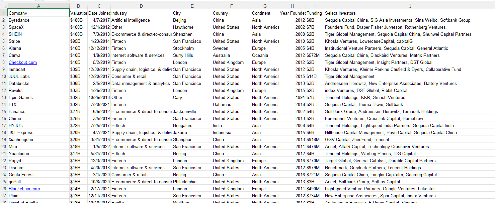
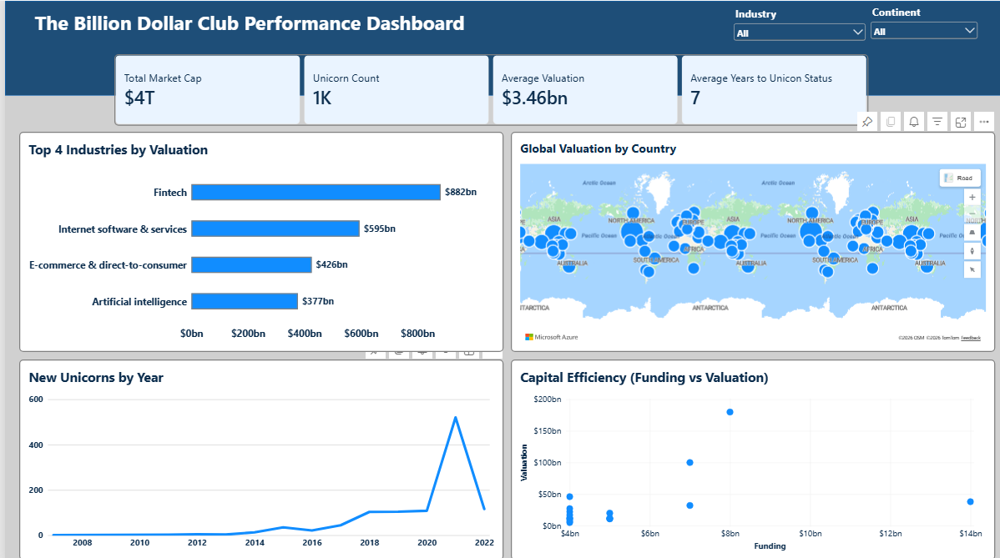

## The “Billion Dollar Club” Performance Report (2007 – 2022)

## Executive Summary
This analysis takes a deep dive into the global landscape of “Unicorn Companies” for several years. It empowers senior investors to identify market trends, geographic hubs, and capital efficiency. It provides insights on the total value of their potential market, how many companies are currently there, the average valuation and how long it takes a company to get to its “Unicorn” status.

## Business Context
The VCs of the club wants to be able to analyze the global landscape of the unicorn companies. The analysis takes into consideration, all companies who have reached their unicorn status and how long it took each company to achieve that.

## Objectives
The analysis answers the following questions:
-	What is the potential value of our potential market?
-	How many companies are there currently?
-	What is the average price tag of a deal?
-	How fast do the companies scale to their unicorn status?

## Data Overview
The analysis is done on a dataset of 1,074 rows and it has 11 rows, covering all required information from 2007 – 2022. The dataset contains information about the companies and which type of industry they are, it also contains the date the company was founded and the date they joined the billion dollar club.

## Data Preview

## Data Cleaning and Transformation
-	The Valuation column was changed from its string value to a fixed decimal number.
-	Null values in the city column was changed to UNKNOWN.
-	A custom column was added to replace the Funding column from its string value to a fixed decimal number.
-	Null values in the funding column was replaced with 0.
-	A dimension date table was also added.

## Detailed Findings and Analysis
### Key Performance Indicators
-	The total value of their potential market or the total market cap was $4 trillion
-	The club had over 1000 companies.
-	The average valuation made was $3.4 billion.
-	It takes a company an average of 7 years to get to their unicorn status.

### Startup boom or bust
-	In 2007, there was only one company that joined the club
-	By 2021, 520 companies joined. 

### Which Industries are creating the most massive wealth
-	The Fintech industry, creates the most wealth, having over $882bn
-	Internet software and services comes next having about $595bn
-	E-commerce and direct-to-customers comes next, having $426bn
-	Artificial Intelligence has $377bn. 
These are the top 4 countries by their valuation.

### Where are the global hotspots for innovation
-	The major hotspots for innovation happened to the in the United States, having a valuation worth over one trillion. This is very specific that the United States contributes a lot geographically.

### Who is efficient with cash and who is just burning cash
-	Bytedance company is a company who is efficient with cash, they received a funding of $8,000,000,000 and had a valuation of 180,000,000,000. This is a really good cash efficiency.
-	Another company good with cash efficiency is SpaceX. They got a funding of $7,000,000,000 and had a valuation of $100,000,000, also showing a goo cash efficiency
-	A company like Xingsheng selected is burning cash, they got a funding of $5,000,000,000 and have a total valuation of $12,000,000,00 showing a really poor cash efficiency.

## Dashboard

## Link to Report
Click here to access the full Power Bi report: [Click Here](https://app.powerbi.com/view?r=eyJrIjoiODM3N2VlNWItODU2ZS00MWVkLTg3ZGUtY2I5MzFiZGFlNjhmIiwidCI6IjZjNzQ3Mzg1LTUyNTktNDcwMS05MTkzLTc5ZTkxNWNlYjA3ZSJ9)

## Tools Used
-	Power Query: Used for cleaning 
-	Power BI Desktop: Used for visualizations and modelling.
## Conclusion
Overall, the analysis shows a strong growth in the global unicorn market, with over 1,000 companies reaching a combined valuation of about $4 trillion. Fintech, internet software, e-commerce, and AI were the leading industries, while companies like ByteDance and SpaceX showed strong cash efficiency. The findings suggest that the global startup market has experienced significant growth, especially in recent years, creating opportunities for investors to identify high-growth industries and companies.

